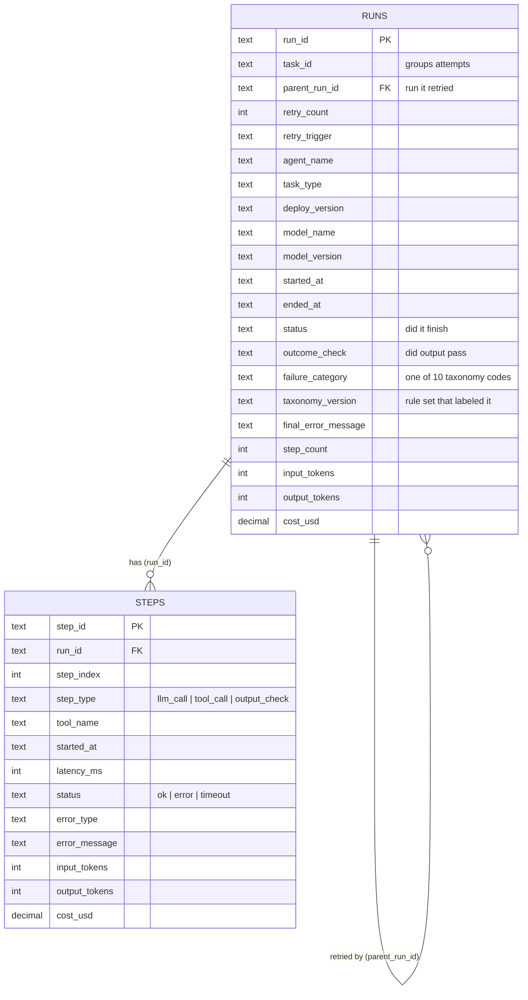

# ARC data model

ARC stores **one row per attempt** in `runs` and **one row per LLM call, tool call or output check** in `steps`.
Retries are new runs that share a `task_id` and point to the run they replaced through `parent_run_id`.

- **Task**: one unit of work an agent was asked to do. Identified by `task_id` (not a separate table in v1).
- **Run**: one attempt at a task. First attempt has `retry_count = 0`.
- **Step**: one LLM call, tool call or output check inside a run.

## Success rule (updated in Step 3)

| status | outcome_check | Result |
| --- | --- | --- |
| completed | passed | Success (verified) |
| completed | skipped | Success (unverified), reported as a share next to TSR with check coverage |
| completed | failed | Failure: `silent_wrong_output` |
| cancelled | any | Neither: excluded from success-rate metrics (updated in Step 4) |
| anything else | any | Failure, classified per [failure-taxonomy.md](failure-taxonomy.md) |

## taxonomy_version

Which version of `classifier/taxonomy.json` set `failure_category`. If a category's share jumps, this tells you whether the
failures changed or the rules did.

## agent_targets

One row per agent, like an uptime SLO per service: `target_task_success_pct`, `max_cost_per_successful_task_usd`,
`error_budget_window_days` (30), `effective_from`. Error budget used = actual failure share / allowed failure share.
Seed values: [`schema/seed_agent_targets.sql`](../schema/seed_agent_targets.sql) for `support-triage`, `code-fix`,
`web-research`, `invoice-entry`.

## Core metrics (per task)

| Metric | Definition |
| --- | --- |
| First-Attempt Success Rate | Tasks whose first run succeeded / finished tasks |
| Task Success Rate (TSR) | Tasks where any run succeeded / finished tasks |
| Retry Recovery Rate | Tasks with a failed first attempt and at least 1 retry that eventually succeeded / all such tasks |
| Cost per Successful Task | All spend, including failed attempts and retries / successful tasks |

DDL: [`schema/schema.sql`](../schema/schema.sql) · Queries: [`schema/metrics.sql`](../schema/metrics.sql)
